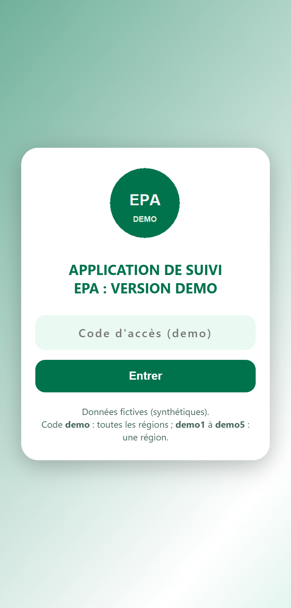
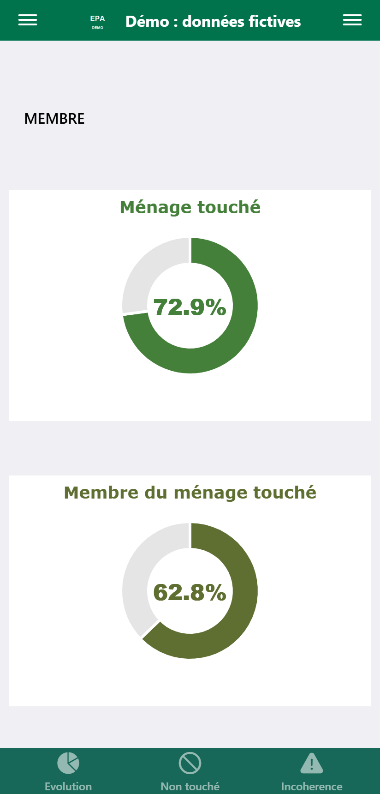
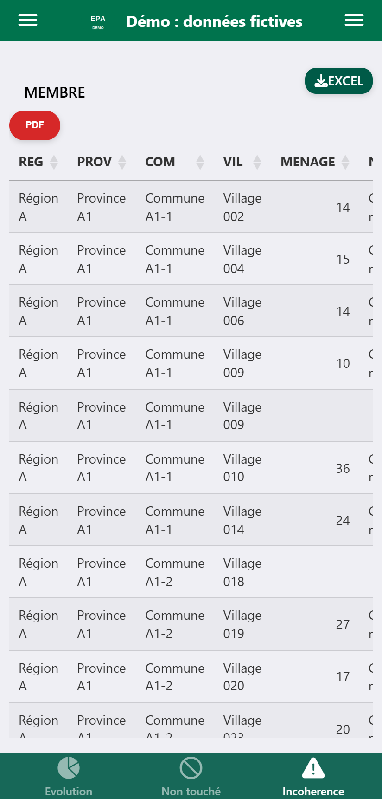

# Survey Fieldwork Monitoring App (ShinyMobile) : demo

A mobile-first R Shiny application to monitor the data collection of a national
agricultural survey in real time: progress of about **860 field enumerators**,
automatic detection of inconsistencies, and drill-down by region, province,
commune and village. The app can be installed on a phone as a Progressive Web App.

> **Data in this repository are synthetic; the original app was used with confidential survey data.**
> All regions, provinces, communes, villages, households, names, observations and progress
> rates in this repository are randomly generated by
> [`data-raw/generer_donnees_fictives.R`](data-raw/generer_donnees_fictives.R).
> No value comes from the real survey.

## Context

The original application was built and used to supervise the fieldwork of a national
agricultural survey (Enquête Permanente Agricole, EPA) conducted by a statistics
department of a ministry of agriculture in West Africa. Supervisors used it daily on their
phones to follow collection progress and send corrections back to enumerators.

## Features

- **Progress dashboard**: donut charts of completion rates per questionnaire (households
  reached, members, plots, livestock, market gardening, crop forecasts, abandoned plots).
  Colours move from red to green as the rate increases.
- **Automatic inconsistency detection**: a table of records flagged by consistency checks
  (for example age incompatible with the household role, plot area out of bounds), with an
  observation describing each problem.
- **"Not reached" tables**: households or plots not yet visited or not yet transmitted.
- **Cascading filters**: region, province, commune, village; every chart and table
  follows the selection.
- **Role-based access**: a national supervisor sees all regions; each regional supervisor
  gets a code that locks the region filter to their own region.
- **Exports**: filtered tables to Excel (`openxlsx`) and PDF (DataTables Buttons), with
  file names built from the active filters and the date.
- **Mobile / PWA**: `shinyMobile` (Framework7) interface, web manifest and service worker,
  so the app can be added to the home screen of a phone.

## Screenshots

<!-- Add screenshots to docs/screenshots/ and update the paths below -->

| Login | Progress | Inconsistencies |
|---|---|---|
|  |  |  |

## Demo access codes

| Code | Role |
|---|---|
| `demo` | National supervisor: all regions |
| `demo1` ... `demo5` | Regional supervisor: Région A ... Région E (region filter locked) |

These codes are public and only protect the demo data. In a production deployment, access
codes should not be stored in the source code (use environment variables or a proper
authentication layer).

## Tech stack

- R, [shiny](https://shiny.posit.co/), [shinyMobile](https://github.com/RinteRface/shinyMobile) (Framework7), shinyjs
- plotly (charts), DT (tables and PDF export), dplyr (data wrangling)
- readxl / openxlsx (Excel input and export)
- PWA: web manifest + Workbox service worker
- Deployment: shinyapps.io

## Run locally

```r
install.packages(c("shiny", "shinyMobile", "shinyjs", "plotly", "dplyr",
                   "DT", "readxl", "openxlsx", "tibble"))

# optional: regenerate the synthetic data (already included in the repository)
source("data-raw/generer_donnees_fictives.R")   # or: Rscript data-raw/generer_donnees_fictives.R

shiny::runApp(".")
```

Then open the app and enter the code `demo`.

## Repository structure

```
app.R                          # the Shiny application (UI + server)
data0.rds                      # sampling frame: one row per enumerator / village
MEMBRE.rds, PARCELLE.rds, ...  # inconsistency tables, one per questionnaire
MEMBRE_NT.rds, ...             # "not reached" tables, one per questionnaire
TAUX_PROGRESSION.xlsx          # progress rates per level (one sheet per questionnaire + LABEL)
data-raw/generer_donnees_fictives.R   # generator of the synthetic data
www/                           # PWA files: icon, manifest, service worker, offline page
```

In production, these data files were refreshed from the survey server by a separate
processing pipeline (not included here).

## Author

**Innocent KIENDREBEOGO** : statistician-economist (ISE).
[LinkedIn](https://www.linkedin.com/in/innocent-kiendrebeogo-86a3a918b/) | [GitHub](https://github.com/iKIENDREBEOGO1)

## License

MIT, see [LICENSE](LICENSE).

---

## Résumé (français)

Application R Shiny (ShinyMobile), pensée pour le téléphone, de suivi de la collecte d'une
enquête agricole nationale : progression d'environ 860 enquêteurs, détection automatique des
incohérences, ménages non touchés, filtres région / province / commune / village, accès par
code (superviseur national ou régional), exports Excel et PDF, installable sur mobile (PWA).

**Les données de ce dépôt sont fictives (générées par `data-raw/generer_donnees_fictives.R`) ;
l'application d'origine était utilisée avec des données d'enquête confidentielles.**
Lancer : `shiny::runApp(".")`, puis saisir le code `demo`.
